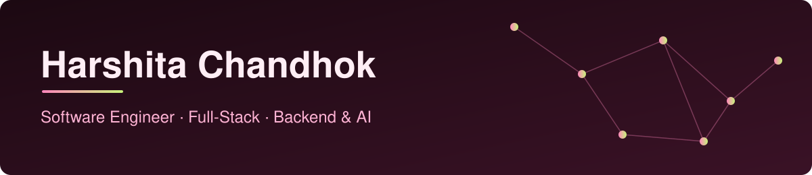

I build web applications end to end, and I care about APIs that stay fast and reliable.

## Engineering toolkit

**Core stack**

**Backend engineering**

         

**AI engineering**

      

## Featured work
<picture>
  <source media="(prefers-color-scheme: dark)" srcset="https://raw.githubusercontent.com/harshita-chandhok/harshita-chandhok/output/github-snake-dark.svg">
  
</picture>
<!-- UNLOCK when a project is live
| Project | What it does |
|---|---|
| [ProjectName](link) | One line on the problem it solves |
-->

## Connect

